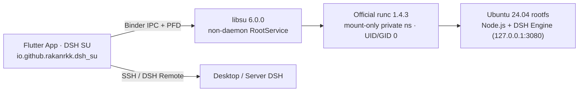

<p align="center">
  <a href="README.md">简体中文</a> · <b>English</b> · <a href="docs/dsh-su.md">dsh-Su Architecture & Status (ZH)</a> · <a href="#build-from-source">Build from Source</a> · <a href="docs/guide/README.md#english">User Guide</a> · <a href="docs/dsh-su-roadmap.en.md">Roadmap &amp; Progress</a>
</p>

<p align="center">
  <picture>
    <source media="(prefers-color-scheme: dark)" srcset="docs/assets/hero-en-dark.webp">
    
  </picture>
</p>

<p align="center">
  DSH SU is a DeepSeek Harness client for rooted Android devices: grant Root and run DSH right on your phone, or drive the one on your computer.
</p>

<p align="center">
  <a href="https://github.com/Rakanrkk/dsh-Su/releases/tag/v1.2.0-dev.1"></a>
  <a href="https://github.com/ccch1mneyyy/dsh-Go"></a>
  <a href="#build-from-source"></a>
  <a href="LICENSE"></a>
  <a href="https://forum.dshtui.com"></a>
  <a href="https://qm.qq.com/q/OEy2RqZnqY"></a>
</p>

## Roadmap and progress

The current priority is a usable Root AI workbench: development trial [`v1.2.0-dev.1`](https://github.com/Rakanrkk/dsh-Su/releases/tag/v1.2.0-dev.1) is published and initially provides an **arm64-v8a** APK. See the [full roadmap](docs/dsh-su-roadmap.en.md) for the launch scope and milestone goals.

| Milestone | Goal |
| --- | --- |
| M1 Usable core product | `1.2.0-dev.1` public development trial → `1.2.0-rc.N` feedback convergence → `1.2.0` release |
| M2 Complete phone execution | Target `1.3.0`: direct system operations, reliable main-screen actions, non-intrusive background execution, user handoff |
| M3 Automation workspace | Target `1.4.0`: status, results and cancellation for scheduled and long jobs; plugin-based tools, skills and workflows |

## About dsh-Su (Root Branch)

This repository is **`dsh-Su`** ([`Rakanrkk/dsh-Su`](https://github.com/Rakanrkk/dsh-Su)), maintained as a minimal patch set in long-term parallel development with upstream [`ccch1mneyyy/dsh-Go`](https://github.com/ccch1mneyyy/dsh-Go) for enthusiasts, phone modders, and developers. It preserves the original UI, chat, tools, plugins, remote host connectivity, author credits, and [AGPL-3.0](LICENSE) license attribution. See [docs/dsh-su.md](docs/dsh-su.md) for architecture and current verification status.



- **Architecture**: `RootService` acts purely as a UID 0 process bridge rather than reimplementing DSH. It uses a `libsu` `6.0.0` non-daemon `RootService` and official `runc` `1.4.3` over the embedded Ubuntu 24.04 rootfs in a mount-only private namespace (no PID namespace, running as `UID/GID 0` with inherited capabilities preserved).
- **Identity and Build Isolation**: Built via `tooling/build-root-apk.sh` (which fetches and verifies official `runc` 1.4.3 binaries through `tooling/fetch-runc-assets.sh`), with package name `io.github.rakanrkk.dsh_su` and launcher label `DSH SU` for side-by-side installation with upstream `DSH Go`. Update sources are isolated to `Rakanrkk/dsh-Su`.
- **Compatibility Targets & Verified Scope**: Development trial `v1.2.0-dev.1` provides an arm64-v8a APK and has completed core-use validation on an Android 14 ARM64 emulator; legacy x86_64 and ARM checks apply to their historical versions only. See [docs/dsh-su.md](docs/dsh-su.md) for results by version, ABI, and root framework.

<br>

<h3 align="center">Deepy and Whale girl keep you company</h3>

<p align="center">They code, flip, wave and nap along with DSH, and can follow you to the home screen.</p>

<p align="center">
  <picture><source media="(prefers-color-scheme: dark)" srcset="docs/assets/pet-deepy-typing-en-dark.gif"></picture> <picture><source media="(prefers-color-scheme: dark)" srcset="docs/assets/pet-deepy-happy-en-dark.gif"></picture> <picture><source media="(prefers-color-scheme: dark)" srcset="docs/assets/pet-deepy-notification-en-dark.gif"></picture> <picture><source media="(prefers-color-scheme: dark)" srcset="docs/assets/pet-deepy-sleeping-en-dark.gif"></picture>
</p>

<p align="center">
  <picture><source media="(prefers-color-scheme: dark)" srcset="docs/assets/pet-girl-typing-en-dark.gif"></picture> <picture><source media="(prefers-color-scheme: dark)" srcset="docs/assets/pet-girl-happy-en-dark.gif"></picture> <picture><source media="(prefers-color-scheme: dark)" srcset="docs/assets/pet-girl-notification-en-dark.gif"></picture> <picture><source media="(prefers-color-scheme: dark)" srcset="docs/assets/pet-girl-sleeping-en-dark.gif"></picture>
</p>

<br>

<a id="download"></a>
<h3 align="center">Downloads & Builds</h3>

<p align="center">The current public development trial of <code>dsh-Su</code> is <a href="https://github.com/Rakanrkk/dsh-Su/releases/tag/v1.2.0-dev.1"><code>v1.2.0-dev.1</code></a>. Releases provides an <code>arm64-v8a</code> APK, public metadata and SHA-256 checksum files; see <a href="docs/dsh-su.md">Architecture &amp; Status</a> for per-framework test scope. For a stable rootless (PRoot) client, download upstream <b>DSH Go</b>.</p>

<p align="center">
  <a href="#build-from-source"></a>&emsp;<a href="https://github.com/ccch1mneyyy/dsh-Go/releases/latest"></a>&emsp;<a href="https://go.dshtui.com/download"></a>
</p>

<p align="center">
  <a href="https://github.com/Rakanrkk/dsh-Su/stargazers"></a>&emsp;<a href="https://github.com/ccch1mneyyy/dsh-Go/stargazers"></a>
</p>

<p align="center">
  <sub>New here? Start with the <a href="docs/guide/README.md">user guide</a>, and bring questions to the <a href="#community">forum and QQ group</a>.</sub><br>
  <sub>An early test build signed with a different key can't be updated in place: uninstall it first, which clears your chats, the Linux environment and settings.</sub>
</p>

<br>

<h3 align="center">Runs on your phone. Drives your computer.</h3>

<p align="center">Grant Root and no separate Termux install is needed; the app prepares the runtime itself. Switch to the DSH on your computer in one tap.</p>

<p align="center">
  <picture>
    <source media="(prefers-color-scheme: dark)" srcset="docs/assets/f-remote-en-dark.webp">
    
  </picture>
</p>

<br>

<h3 align="center">Chime in, interrupt, stay tidy</h3>

<p align="center">Send a message while DSH is replying, and tap "Send now" whenever you like. Finished steps fold into one line.</p>

<p align="center">
  <picture>
    <source media="(prefers-color-scheme: dark)" srcset="docs/assets/f-steer-en-dark.webp">
    
  </picture>
</p>

<br>

<h3 align="center">Native, with the web interface one tap away</h3>

<p align="center">Switch between the native app and the official web interface on the same chat. It reopens in whichever you used last.</p>

<p align="center">
  <picture>
    <source media="(prefers-color-scheme: dark)" srcset="docs/assets/f-web-en-dark.webp">
    
  </picture>
</p>

<br>

<h3 align="center">Share cards, replays and links</h3>

<p align="center">Turn a reply into a share card. Share a whole chat as a link that replays in any browser, end-to-end encrypted.</p>

<p align="center">
  <picture>
    <source media="(prefers-color-scheme: dark)" srcset="docs/assets/f-share-en-dark.webp">
    
  </picture>
</p>

<br>

<h3 align="center">Landscape and tablets</h3>

<p align="center">New layouts for landscape phones and tablets: the sidebar stays, content stays centered, the keyboard never crowds.</p>

<p align="center">
  <picture>
    <source media="(prefers-color-scheme: dark)" srcset="docs/assets/f-adaptive-en-dark.webp">
    
  </picture>
</p>

<br>

<h3 align="center">Colors and home screen icons</h3>

<p align="center">Six accent colors, your wallpaper's, or your own. Four home screen icons and three icon styles.</p>

<p align="center">
  <picture>
    <source media="(prefers-color-scheme: dark)" srcset="docs/assets/f-theme-en-dark.webp">
    
  </picture>
</p>

<br>

<h3 align="center">English and 中文</h3>

<p align="center">The whole app speaks both. It follows your system, or pick one in Settings.</p>

<p align="center">
  <picture>
    <source media="(prefers-color-scheme: dark)" srcset="docs/assets/f-lang-dark.webp">
    
  </picture>
</p>

<br>

<h3 align="center">Phone control</h3>

<p align="center">DSH reads the screen and taps for you. Payments, passwords and codes always stay with you.</p>

<p align="center">
  <picture>
    <source media="(prefers-color-scheme: dark)" srcset="docs/assets/f-phone-en-dark.webp">
    
  </picture>
</p>

<br>

## Features

dsh-Su combines a chat interface, an on-device runtime and remote connections. It is a third-party project built on [DeepSeek Harness](https://github.com/deepseek-ai/deepseek-harness). The DSH engine runs on your phone; model requests are still handled by the model provider you configure.

- **On-device runtime:** with Root granted, the app installs Ubuntu, Node.js and DSH itself, with no separate Termux installation.
- **Remote connections:** use DSH on a computer or server through SSH or [DSHarness Remote](https://github.com/liguobao/ds-harness-remote).
- **Chat and tools:** switch models, send images, use voice input, and respond to tool approvals and questions. Chat and web interfaces are available.
- **Plugin interfaces:** use native tool cards, forms and panels from plugins adapted for DSH. This repository includes an SDK, guides and examples.
- **Phone control:** after you enable the required permissions, let the local engine read the screen, tap and type. You can stop it at any time.
- **Sharing and appearance:** share, export and replay conversations, and customize themes, icons and pets.

Capabilities depend on the host and connection. DSHarness Remote currently accepts image attachments only, does not open the web interface inside the app, limits plugin management to enabling or disabling plugins, and does not support DS Bot or conversation-log export. See [Engine and remote hosts](docs/guide/en/03-engine-hosts.md).

## Install

Installation requires Android 8.0 (API 26) or later. The current `v1.2.0-dev.1` development trial provides an **arm64-v8a** APK with a SHA-256 checksum and public metadata JSON file. This repository has no 32-bit ARM build.

1. Download the arm64-v8a APK from [dsh-Su `v1.2.0-dev.1` Releases](https://github.com/Rakanrkk/dsh-Su/releases/tag/v1.2.0-dev.1). When you first start the on-device engine, allow `DSH SU` in your root manager. Upstream rootless PRoot builds are available at [ccch1mneyyy/dsh-Go Releases](https://github.com/ccch1mneyyy/dsh-Go/releases/latest) and the [download page](https://go.dshtui.com/download).
2. On first launch, choose an on-device runtime or a remote host.
3. Configure a model and its credentials for the selected host, then start a conversation. Some remote providers must be configured on the host itself.

A remote-only setup does not need a local runtime on the phone. Phone control works with the local engine outside safe mode and requires permissions such as Accessibility, as explained in the app. Non-disruptive mode additionally requires Android 14 or later and Shizuku or self-ADB. Follow the [user guide](docs/guide/README.md) for setup.

Upstream builds use PRoot startup by default; `dsh-Su` (`BuildConfig.ROOT_RUNTIME = true`) launches the local container runtime through `libsu` `RootService` + `runc` (see [docs/dsh-su.md](docs/dsh-su.md)). The current Android build targets APK sideloading, not Google Play distribution.

## Data and permissions

Model requests go to the provider you configure. During phone-control tasks, relevant screen text may be sent to the model, and vision-capable models may receive screenshots. Read the app's permission disclosure before enabling the feature.

“Send anonymous usage statistics” is on by default. You can turn it off during onboarding or in Settings → Privacy and sharing. See [Troubleshooting](docs/guide/en/11-faq.md) for the fields collected and what happens when it is disabled. Review content before sharing it; recipients can save a copy of a shared link or file's contents.

## FAQ

<details>
<summary><b>Is this an official DeepSeek app?</b></summary>
<br>

No. dsh-Su is an unofficial client made by the community, built on the open-source [DeepSeek Harness](https://github.com/deepseek-ai/deepseek-harness). DSH itself runs on your phone; model requests go to the provider you configure, so it needs a connection and bills your account with that provider.

</details>

<details>
<summary><b>Is it safe?</b></summary>
<br>

The local web interface only answers to the app itself. Shared links are end-to-end encrypted: the key lives only in the link, and the server never sees the content. Phone control always hands payments, passwords, codes and system settings back to you.

</details>

<details>
<summary><b>Will the system kill it in the background?</b></summary>
<br>

Some battery savers hold apps back. When that happens, the app tells you and opens the right setting, on vivo, Xiaomi, Huawei, Honor and OPPO.

</details>

<details>
<summary><b>What phone do I need?</b></summary>
<br>

Android 8 or later. On a phone, download the package on the Releases page; the current development trial provides arm64-v8a only. Running DSH on the phone needs the built-in environment, so keep about 1 GB free; connecting to DSH on a computer or server doesn't.

</details>

<details>
<summary><b>Is it open source?</b></summary>
<br>

Yes. The code is in this repository under [AGPL-3.0](LICENSE); `sdk/` and `examples/` are MIT. The DSH Go name and logo, and the mascots Deepy and Whale girl, are not covered by the open-source license; see [ASSETS.md](ASSETS.md).

</details>

<a id="build-from-source"></a>
## Build from source

The following workflow targets **Linux x86_64**. The toolchain script currently defaults to JDK 17, Flutter 3.47.7 and the Android SDK/NDK. The app requires Dart `^3.13.5`. Prepare Bash, Git, curl, tar, unzip, xz, Python 3, zstd (for unpacking zstd-compressed deb archives when Python does not provide `compression.zstd`), file and standard GNU utilities. Resolving Ubuntu package locks again also requires gpgv.

Start with the complete source tree and project assets. Fonts, images and other files declared in `app/pubspec.yaml` are build inputs. The following script generates the runtime bundle.

```bash
git clone https://github.com/Rakanrkk/dsh-Su.git
cd dsh-Su

bash tooling/setup-toolchain.sh
source tooling/env.sh
flutter --version
java -version

bash runtime/build-runtime.sh arm64-v8a
# Build dsh-Su (fetches and verifies official runc 1.4.3, package io.github.rakanrkk.dsh_su, label DSH SU)
bash tooling/build-root-apk.sh -f arm64 --keep-daemon

# Or build the default upstream PRoot package (package io.github.ccch1mneyyy.dsh_app)
DSH_BETA_TOKEN_FILE= bash tooling/build-apk.sh -f arm64 --keep-daemon
```

The toolchain script downloads the SDK/NDK and emulator images and runs Android SDK license acceptance. Its default location is `~/dev`; set `DEV_ROOT` to use a separate directory. The script reuses existing installations, so check their versions before building.

The output is `app/build/app/outputs/flutter-apk/app-arm64-release.apk`. Runtime assembly uses the versions and verification data pinned in the repository and needs network access to download dependencies. `DSH_BETA_TOKEN_FILE=` leaves out the maintainer's beta-channel token. `--keep-daemon` preserves Gradle daemons, which is useful when working on other Android projects at the same time.

For an x86_64 APK, generate its runtime first:

```bash
bash runtime/build-runtime.sh x86_64
bash tooling/build-root-apk.sh -f x64 --keep-daemon
DSH_BETA_TOKEN_FILE= bash tooling/build-apk.sh -f x64 --keep-daemon
```

Without `app/android/key.properties`, a local release build uses debug signing. It cannot replace an official installation signed with a different key. Use a test device and preserve existing data; do not uninstall your daily-use app just to resolve a signing mismatch. Do not commit signing keys or their configuration.

To inspect APK build commands without building:

```bash
bash tooling/build-root-apk.sh --dry-run -f all
DSH_BETA_TOKEN_FILE= bash tooling/build-apk.sh --dry-run -f all
```

## Repository layout

| Path | Contents |
| --- | --- |
| `app/` | Flutter interface and Android Kotlin platform code |
| `packages/dsh_client/` | Dart client for the DSH Web API |
| `packages/dsh_remote/` | Dart client for DSH Remote |
| `runtime/` | Linux runtime assembly, engine patches and the app bridge |
| `sdk/plugin-kit/` | Native plugin authoring kit, used from the repository and not published to npm |
| `examples/plugins/` | Example plugins |
| `docs/dsh-su.md` | `dsh-Su` Root architecture, status and verification notes |
| `docs/guide/`, `docs/plugins/` | User and plugin development guides |
| `docs/assets/` | Showcase images, pet animations and community QR codes used on this page |
| `tooling/` | Toolchain, `build-root-apk.sh` / `build-apk.sh` build and diagnostic scripts |
| `services/`, `site/`, `infra/` | Companion sharing service, website and deployment materials |

## Contribute

Report bugs and suggest improvements in [Rakanrkk/dsh-Su Issues](https://github.com/Rakanrkk/dsh-Su/issues). For code, documentation and translation changes, start with [CONTRIBUTING.en.md](CONTRIBUTING.en.md). Plugin authors can use the [plugin guides](docs/plugins/en/README.md) and [SDK](sdk/plugin-kit/README.en.md).

Report security issues through [SECURITY.en.md](SECURITY.en.md). Keep vulnerability details and credentials out of public issues.

<a id="community"></a>

## Community

- **Forum**: [forum.dshtui.com](https://forum.dshtui.com)
- **QQ group**: `1132118290` ([join](https://qm.qq.com/q/OEy2RqZnqY))
- **WeChat group**: scan the code below; if it has expired, join the QQ group
<!-- Telegram: link to come, add a line here -->

<p align="center">
  <a href="https://qm.qq.com/q/OEy2RqZnqY"><picture><source media="(prefers-color-scheme: dark)" srcset="docs/assets/qr-qq-en-dark.webp"></picture></a>&emsp;&emsp;<picture><source media="(prefers-color-scheme: dark)" srcset="docs/assets/qr-wechat-en-dark.webp"></picture>
</p>

<p align="center">
  <sub>QQ group <code>1132118290</code>. On a computer, <a href="https://qm.qq.com/q/OEy2RqZnqY">join with one click</a>. The WeChat code changes every week; if it has expired, join the QQ group.</sub>
</p>

## Friends' Links

- **[DSH-TUI](https://dshtui.com/)**: the interactive terminal UI for DeepSeek Harness by the same author — the desktop counterpart to dsh-Su, with a pixel whale, live status and time travel ([GitHub](https://github.com/ccch1mneyyy/dsh-TUI)).

## License and acknowledgments

This project is licensed under [AGPL-3.0](LICENSE). `sdk/` and `examples/` remain **MIT**. Third-party code and assets retain the terms stated in their own notices.

- [DSH Go (`ccch1mneyyy/dsh-Go`)](https://github.com/ccch1mneyyy/dsh-Go): the upstream repository and full application base of `dsh-Su`.
- [DeepSeek Harness](https://github.com/deepseek-ai/deepseek-harness): the agent DSH Go runs and connects to.
- [DSH-TUI](https://github.com/ccch1mneyyy/dsh-TUI): home of the mascots, Deepy and Whale girl.

Code derived from Phase is used with the author's permission. DeepSeek Harness, PiPilot, DS Bot, DSH Remote and other third-party components and assets retain their own licenses and attribution. See [THIRD_PARTY_NOTICES.md](THIRD_PARTY_NOTICES.md) for sources and terms.

The DSH Go name, logo and mascots (Deepy and Whale girl) are not covered by the AGPL; see [ASSETS.md](ASSETS.md) for their terms.

<sub>Remote connections draw on the [ds-harness-remote](https://github.com/liguobao/ds-harness-remote) project and its server. Thanks to its author, liguobao.</sub>

<br>

<p align="center"><sub>dsh-Su is an unofficial client made by the community. It is not affiliated with or endorsed by DeepSeek. DeepSeek names and marks belong to their owners.</sub></p>
