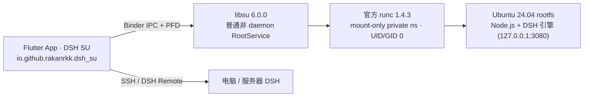

<p align="center">
  <b>简体中文</b> · <a href="README.en.md">English</a> · <a href="docs/dsh-su.md">dsh-Su 架构与状态</a> · <a href="#build-from-source">从源码构建</a> · <a href="docs/guide/README.md">使用指南</a> · <a href="docs/dsh-su-roadmap.md">开发计划与进度</a>
</p>

<p align="center">
  <picture>
    <source media="(prefers-color-scheme: dark)" srcset="docs/assets/hero-zh-dark.webp">
    
  </picture>
</p>

<p align="center">
  DSH SU 是面向已 Root Android 设备的 DeepSeek Harness 客户端：授予 Root 后在手机上直接运行，也能遥控你电脑上的 DSH。
</p>

<p align="center">
  <a href="https://github.com/Rakanrkk/dsh-Su/releases/tag/v1.2.0-dev.1"></a>
  <a href="https://github.com/ccch1mneyyy/dsh-Go"></a>
  <a href="#build-from-source"></a>
  <a href="LICENSE"></a>
  <a href="https://forum.dshtui.com"></a>
  <a href="https://qm.qq.com/q/OEy2RqZnqY"></a>
</p>

## 开发计划与进度

当前优先交付可实际使用的 Root AI 工作台：开发试用版 [`v1.2.0-dev.1`](https://github.com/Rakanrkk/dsh-Su/releases/tag/v1.2.0-dev.1) 已公开发布，首发提供 **arm64-v8a** APK。首发范围与里程碑目标见[完整路线图](docs/dsh-su-roadmap.md)。

| 里程碑 | 目标 |
| --- | --- |
| M1 可用核心产品 | `1.2.0-dev.1` 公开开发试用 → `1.2.0-rc.N` 收敛反馈 → 正式发布 `1.2.0` |
| M2 完整手机执行 | 目标 `1.3.0`：系统直接操作、主屏可靠动作、后台不打扰执行，用户可随时接手 |
| M3 自动化工作台 | 目标 `1.4.0`：调度与长任务的状态、结果、取消；复用插件扩展工具、技能和工作流 |

## 关于 dsh-Su（Root 分支说明）

本仓库是 **`dsh-Su`**（[`Rakanrkk/dsh-Su`](https://github.com/Rakanrkk/dsh-Su)），面向极客、玩机者与开发者，以最小上游补丁集方式与 [`ccch1mneyyy/dsh-Go`](https://github.com/ccch1mneyyy/dsh-Go) 长期平行开发，完整保留原版主界面、聊天、工具、插件、远程主机能力以及原作者版权与 [AGPL-3.0](LICENSE) 许可证归属。详细架构与验证进展见 [docs/dsh-su.md](docs/dsh-su.md)。



- **架构定位**：`RootService` 仅作为 UID 0 进程桥，不重新实现 DSH。通过 `libsu` `6.0.0` 普通非 daemon `RootService` 驱动官方 `runc` `1.4.3`，在原版 Ubuntu rootfs 上开启独立 `mount` 私有命名空间（无 PID namespace，以 `UID/GID 0` 运行并保留继承的 capabilities）。
- **身份与构建隔离**：构建入口为 `tooling/build-root-apk.sh`（自动通过 `tooling/fetch-runc-assets.sh` 拉取并校验官方 `runc` 1.4.3 双架构二进制），应用包名为 `io.github.rakanrkk.dsh_su`、桌面名称为 `DSH SU`，可与原版 `DSH Go` 并存安装；更新源隔离至 `Rakanrkk/dsh-Su`。
- **兼容目标与当前验证范围**：开发试用版 `v1.2.0-dev.1` 提供 arm64-v8a APK，已在 Android 14 ARM64 模拟器完成核心使用验证；旧 x86_64 与历史 ARM 验证仅适用于对应历史版本。各版本、ABI 与 Root 框架的验证范围见 [docs/dsh-su.md](docs/dsh-su.md)。

<br>

<h3 align="center">Deepy 和鲸娘，陪你干活</h3>

<p align="center">干活时敲代码，做完来个空翻，等你确认会举手。打开「App 外显示」，它们还会跟你到桌面。</p>

<p align="center">
  <picture><source media="(prefers-color-scheme: dark)" srcset="docs/assets/pet-deepy-typing-zh-dark.gif"></picture> <picture><source media="(prefers-color-scheme: dark)" srcset="docs/assets/pet-deepy-happy-zh-dark.gif"></picture> <picture><source media="(prefers-color-scheme: dark)" srcset="docs/assets/pet-deepy-notification-zh-dark.gif"></picture> <picture><source media="(prefers-color-scheme: dark)" srcset="docs/assets/pet-deepy-sleeping-zh-dark.gif"></picture>
</p>

<p align="center">
  <picture><source media="(prefers-color-scheme: dark)" srcset="docs/assets/pet-girl-typing-zh-dark.gif"></picture> <picture><source media="(prefers-color-scheme: dark)" srcset="docs/assets/pet-girl-happy-zh-dark.gif"></picture> <picture><source media="(prefers-color-scheme: dark)" srcset="docs/assets/pet-girl-notification-zh-dark.gif"></picture> <picture><source media="(prefers-color-scheme: dark)" srcset="docs/assets/pet-girl-sleeping-zh-dark.gif"></picture>
</p>

<br>

<a id="download"></a>
<h3 align="center">下载与构建</h3>

<p align="center"><code>dsh-Su</code> 当前公开开发试用版为 <a href="https://github.com/Rakanrkk/dsh-Su/releases/tag/v1.2.0-dev.1"><code>v1.2.0-dev.1</code></a>，Releases 提供 <code>arm64-v8a</code> APK、公开元数据及 SHA-256 校验文件；各框架实测范围见<a href="docs/dsh-su.md">架构与状态说明</a>。如需稳定的免 Root（PRoot）客户端，请从上游下载原版 <b>DSH Go</b>。</p>

<p align="center">
  <a href="#build-from-source"></a>&emsp;<a href="https://github.com/ccch1mneyyy/dsh-Go/releases/latest"></a>&emsp;<a href="https://go.dshtui.com/download"></a>
</p>

<p align="center">
  <a href="https://github.com/Rakanrkk/dsh-Su/stargazers"></a>&emsp;<a href="https://github.com/ccch1mneyyy/dsh-Go/stargazers"></a>
</p>

<p align="center">
  <sub>第一次用可以先看<a href="docs/guide/README.md">使用指南</a>，遇到问题欢迎来<a href="#community">论坛和 QQ 群</a>。</sub><br>
  <sub>手机上装过签名不同的早期测试包时不能直接覆盖安装，需要先卸载旧版；卸载会清空对话、Linux 环境和设置。</sub>
</p>

<br>

<h3 align="center">本机运行，也能遥控电脑</h3>

<p align="center">授予 Root 后无需另装 Termux，App 自动准备运行环境。电脑上的 DSH，也能一键切过去接着用。</p>

<p align="center">
  <picture>
    <source media="(prefers-color-scheme: dark)" srcset="docs/assets/f-remote-zh-dark.webp">
    
  </picture>
</p>

<br>

<h3 align="center">插话、打断，过程自动收好</h3>

<p align="center">回复中途也能插话，排队的消息随时「立即发送」。做完的过程折叠成一行。</p>

<p align="center">
  <picture>
    <source media="(prefers-color-scheme: dark)" srcset="docs/assets/f-steer-zh-dark.webp">
    
  </picture>
</p>

<br>

<h3 align="center">原生界面，也有网页版</h3>

<p align="center">和官方网页版一键切换，停在同一段对话，下次打开还是你上次用的那个。</p>

<p align="center">
  <picture>
    <source media="(prefers-color-scheme: dark)" srcset="docs/assets/f-web-zh-dark.webp">
    
  </picture>
</p>

<br>

<h3 align="center">分享卡、对话回放和链接</h3>

<p align="center">回复一键做成分享卡。整段对话生成链接，对方在浏览器里回放，链接端到端加密。</p>

<p align="center">
  <picture>
    <source media="(prefers-color-scheme: dark)" srcset="docs/assets/f-share-zh-dark.webp">
    
  </picture>
</p>

<br>

<h3 align="center">横屏与平板</h3>

<p align="center">横屏手机和平板重新排版：侧栏常驻，内容居中，弹出键盘也不挤。</p>

<p align="center">
  <picture>
    <source media="(prefers-color-scheme: dark)" srcset="docs/assets/f-adaptive-zh-dark.webp">
    
  </picture>
</p>

<br>

<h3 align="center">主题配色与桌面图标</h3>

<p align="center">六套主题色，也能跟随壁纸或自选颜色。四款桌面图标，三种功能图标风格。</p>

<p align="center">
  <picture>
    <source media="(prefers-color-scheme: dark)" srcset="docs/assets/f-theme-zh-dark.webp">
    
  </picture>
</p>

<br>

<h3 align="center">中文，也说 English</h3>

<p align="center">全部界面支持英文，在设置里切换，默认跟随系统。</p>

<p align="center">
  <picture>
    <source media="(prefers-color-scheme: dark)" srcset="docs/assets/f-lang-dark.webp">
    
  </picture>
</p>

<br>

<h3 align="center">手机操控</h3>

<p align="center">看屏幕、帮你点，三档确认随你选。付款、密码和验证码，永远交还给你。</p>

<p align="center">
  <picture>
    <source media="(prefers-color-scheme: dark)" srcset="docs/assets/f-phone-zh-dark.webp">
    
  </picture>
</p>

<br>

## 可以做什么

dsh-Su 提供聊天界面、本机运行环境和远程连接，是基于 [DeepSeek Harness](https://github.com/deepseek-ai/deepseek-harness) 的第三方项目。运行在手机上的是 DSH 引擎；模型请求仍由你配置的模型提供方处理。

- **本机运行**：授予 Root 后，App 自动安装 Ubuntu、Node.js 与 DSH 运行环境，无需另装 Termux。
- **远程连接**：通过 SSH 或 [DSHarness Remote](https://github.com/liguobao/ds-harness-remote) 使用电脑、服务器上的 DSH。
- **聊天与工具**：切换模型，发送图片、使用语音输入，处理工具审批和提问；支持聊天界面与网页模式。
- **插件界面**：使用适配 DSH 的原生工具卡、表单和面板；仓库提供 SDK、教程和示例。
- **手机操控**：在你开启权限后，让本机引擎读取屏幕、点按和输入，并可随时停止。
- **分享与外观**：分享、导出和回放对话，调整主题、图标和桌宠。

功能随主机和连接方式不同。DSHarness Remote 当前只支持图片附件，不能在 App 内打开网页版，插件管理限于开关，且不支持 DS Bot 和对话日志导出。详见[本机引擎与远程主机](docs/guide/zh/03-engine-hosts.md)。

## 安装

安装要求为 Android 8.0（API 26）及以上。当前 `v1.2.0-dev.1` 开发试用版提供 **arm64-v8a** APK，附 SHA-256 校验文件与公开元数据 JSON。仓库没有 32 位 ARM 构建。

1. 从 [dsh-Su `v1.2.0-dev.1` Releases](https://github.com/Rakanrkk/dsh-Su/releases/tag/v1.2.0-dev.1) 下载 arm64-v8a APK；首次启动本机引擎时，在 Root 管理器允许 `DSH SU`。上游原版免 Root 安装包见 [ccch1mneyyy/dsh-Go Releases](https://github.com/ccch1mneyyy/dsh-Go/releases/latest) 与[官网下载页](https://go.dshtui.com/download)。
2. 首次启动时，选择在本机安装运行环境，或连接远程主机。
3. 为所选主机配置模型和所需凭据，再开始对话；部分远程渠道需要在主机侧配置。

仅连接远程主机时，不必在手机上安装本机运行环境。手机操控只对正常模式下的本机引擎开放，需要按界面说明开启无障碍等权限；不打扰模式另外要求 Android 14 及以上，以及 Shizuku 或自连 ADB。首次使用可按[使用指南](docs/guide/README.md)逐项配置。

上游原版默认使用 PRoot 兼容启动；`dsh-Su`（`BuildConfig.ROOT_RUNTIME = true`）使用 `libsu` `RootService` + `runc` 启动本地容器环境，详见 [docs/dsh-su.md](docs/dsh-su.md)。当前 Android 构建以 APK 侧载为目标，不是 Google Play 发布配置。

## 数据与权限

模型请求会发送给你配置的提供方。开启手机操控后，任务需要的屏幕文字可能发送给模型，支持看图的模型也可能收到截图；请先阅读 App 的权限说明。

“发送匿名使用统计”默认开启，可在首次引导或“设置 → 隐私与分享”关闭。采集范围和关闭后的处理见[常见问题](docs/guide/zh/11-faq.md)。分享内容前，请检查预览；收到链接或文件的人可以保存其中的内容。

## 常见问题

<details>
<summary><b>和 DeepSeek 官方是什么关系？</b></summary>
<br>

没有关系。dsh-Su 是社区开发的非官方客户端，基于开源的 [DeepSeek Harness](https://github.com/deepseek-ai/deepseek-harness) 构建。手机上运行的是 DSH 本身；模型请求发给你配置的模型提供方，需要联网，按你在提供方的账户计费。

</details>

<details>
<summary><b>安全吗？</b></summary>
<br>

本机网页版只接受 App 自己的访问。分享链接端到端加密，密钥只在链接里，服务器看不到内容。手机操控遇到付款、密码、验证码和系统设置，一律交还给你。

</details>

<details>
<summary><b>切到后台会被杀吗？</b></summary>
<br>

部分系统的省电策略会拦住后台。App 发现后会提醒你，并直达对应的放行设置，vivo、小米、华为、荣耀、OPPO 都有。

</details>

<details>
<summary><b>对手机有什么要求？</b></summary>
<br>

Android 8 及以上。手机直接下载 Release 页面上的安装包即可；当前开发试用版只提供 arm64-v8a。在手机上运行 DSH 要先准备内置的运行环境，请预留约 1 GB 空间；只连电脑或服务器上的 DSH 可以不装。

</details>

<details>
<summary><b>开源吗？</b></summary>
<br>

开源，代码就在这个仓库，以 [AGPL-3.0](LICENSE) 发布，`sdk/` 和 `examples/` 为 MIT。DSH Go 的名称和标识，以及 Deepy、鲸娘两位吉祥物，不在开源授权范围内，见 [ASSETS.md](ASSETS.md)。

</details>

<a id="build-from-source"></a>
## 从源码构建

以下流程面向 **Linux x86_64**。当前工具链脚本默认安装 JDK 17、Flutter 3.47.7 和 Android SDK/NDK；App 要求 Dart `^3.13.5`。准备 Bash、Git、curl、tar、unzip、xz、Python 3、zstd（Python 未提供 `compression.zstd` 时用于解包 zstd 压缩的 deb）、file 和常见 GNU 命令；重新解析 Ubuntu 软件包锁时还需要 gpgv。

先取得完整源码和项目资源。`app/pubspec.yaml` 声明的字体、图片等都是构建输入，运行时包由下面的脚本生成。

```bash
git clone https://github.com/Rakanrkk/dsh-Su.git
cd dsh-Su

bash tooling/setup-toolchain.sh
source tooling/env.sh
flutter --version
java -version

bash runtime/build-runtime.sh arm64-v8a
# 构建 dsh-Su（自动拉取并校验官方 runc 1.4.3，包名 io.github.rakanrkk.dsh_su，桌面名 DSH SU）
bash tooling/build-root-apk.sh -f arm64 --keep-daemon

# 或构建与上游一致的默认 PRoot 包（包名 io.github.ccch1mneyyy.dsh_app）
DSH_BETA_TOKEN_FILE= bash tooling/build-apk.sh -f arm64 --keep-daemon
```

工具链脚本会下载 SDK/NDK 与模拟器镜像，并执行 Android SDK 许可接受步骤。默认安装到 `~/dev`；可通过 `DEV_ROOT` 指定独立目录。脚本会复用已有安装，构建前请核对版本。

产物为 `app/build/app/outputs/flutter-apk/app-arm64-release.apk`。运行时构建使用仓库固定的版本与校验信息，并需要联网下载依赖。示例中的 `DSH_BETA_TOKEN_FILE=` 不嵌入维护者的内测通道令牌；`--keep-daemon` 保留 Gradle daemon，适合同时开发其他 Android 项目的环境。

构建 x86_64 包时，先生成对应运行时：

```bash
bash runtime/build-runtime.sh x86_64
bash tooling/build-root-apk.sh -f x64 --keep-daemon
DSH_BETA_TOKEN_FILE= bash tooling/build-apk.sh -f x64 --keep-daemon
```

未配置 `app/android/key.properties` 时，本地 release 构建使用 debug 签名。它不能直接覆盖不同签名的官方安装包；请在测试设备上安装，保留已有数据，不要为解决签名冲突直接卸载正在使用的 App。发布签名与密钥文件不要提交到仓库。

只查看 APK 构建命令，可运行：

```bash
bash tooling/build-root-apk.sh --dry-run -f all
DSH_BETA_TOKEN_FILE= bash tooling/build-apk.sh --dry-run -f all
```

## 目录

| 路径 | 内容 |
| --- | --- |
| `app/` | Flutter 界面与 Android Kotlin 平台实现 |
| `packages/dsh_client/` | DSH Web API 的 Dart 客户端 |
| `packages/dsh_remote/` | DSH Remote 的 Dart 客户端 |
| `runtime/` | Linux 运行时打包、引擎补丁与 App 桥接 |
| `sdk/plugin-kit/` | 原生插件作者工具包；在仓库中使用，未发布到 npm |
| `examples/plugins/` | 插件示例 |
| `docs/dsh-su.md` | `dsh-Su` Root 架构设计、开发状态与验证说明 |
| `docs/guide/`、`docs/plugins/` | 用户指南与插件开发文档 |
| `docs/assets/` | 本页用到的展示图、桌宠动图和社群二维码 |
| `tooling/` | 工具链、`build-root-apk.sh` / `build-apk.sh` 构建与诊断脚本 |
| `services/`、`site/`、`infra/` | 配套分享服务、网站和部署材料 |

## 参与贡献

问题反馈和改进建议可提交到 [Rakanrkk/dsh-Su Issues](https://github.com/Rakanrkk/dsh-Su/issues)。代码、文档和翻译贡献请先看 [CONTRIBUTING.md](CONTRIBUTING.md)。插件作者可以从[插件教程](docs/plugins/README.md)和 [SDK](sdk/plugin-kit/README.md)开始。

安全问题请按 [SECURITY.md](SECURITY.md) 报告，避免在公开 Issue 中提交漏洞细节或凭据。

<a id="community"></a>

## 社区

- **论坛**：[forum.dshtui.com](https://forum.dshtui.com)
- **QQ 群**：`1132118290`（[点此加群](https://qm.qq.com/q/OEy2RqZnqY)）
- **微信群**：扫下方二维码，过期请加 QQ 群
<!-- Telegram：链接待定，拿到后加一行 -->

<p align="center">
  <a href="https://qm.qq.com/q/OEy2RqZnqY"><picture><source media="(prefers-color-scheme: dark)" srcset="docs/assets/qr-qq-zh-dark.webp"></picture></a>&emsp;&emsp;<picture><source media="(prefers-color-scheme: dark)" srcset="docs/assets/qr-wechat-zh-dark.webp"></picture>
</p>

<p align="center">
  <sub>QQ 群号 <code>1132118290</code>，电脑上可<a href="https://qm.qq.com/q/OEy2RqZnqY">直接点此加群</a>。微信群二维码每周更新，过期请加 QQ 群。</sub>
</p>

## 友情链接

- **[DSH-TUI](https://dshtui.com/)**：同一作者的作品，面向 DeepSeek Harness 的交互式终端界面。手机上用 dsh-Su，电脑上就用它——像素鲸鱼、实时状态、时间回溯，装上即开工（[GitHub](https://github.com/ccch1mneyyy/dsh-TUI)）。

## 许可证与致谢

本项目采用 [AGPL-3.0](LICENSE)；`sdk/` 和 `examples/` 保持 **MIT**。第三方代码和素材以各自声明为准。

- [DSH Go (`ccch1mneyyy/dsh-Go`)](https://github.com/ccch1mneyyy/dsh-Go)：`dsh-Su` 的上游仓库与完整应用基底。
- [DeepSeek Harness](https://github.com/deepseek-ai/deepseek-harness)：DSH Go 运行和连接的就是它。
- [DSH-TUI](https://github.com/ccch1mneyyy/dsh-TUI)：吉祥物 Deepy 小鲸鱼和鲸娘来自这里。

Phase 相关代码经作者许可使用。DeepSeek Harness、PiPilot、DS Bot、DSH Remote 及其他第三方组件、素材保留各自的许可证和署名。具体来源和条款见 [THIRD_PARTY_NOTICES.md](THIRD_PARTY_NOTICES.md)。

DSH Go 的名称、标识、Deepy 小鲸鱼和鲸娘等形象不在 AGPL 授权范围内，使用条款见 [ASSETS.md](ASSETS.md)。

<sub>远程连接参考了 [ds-harness-remote](https://github.com/liguobao/ds-harness-remote) 的项目和服务器，感谢作者李国宝。</sub>

<br>

<p align="center"><sub>dsh-Su 是社区开发的非官方客户端，与 DeepSeek 没有关联，也不代表 DeepSeek。DeepSeek 名称与标识归其所有者所有。</sub></p>
