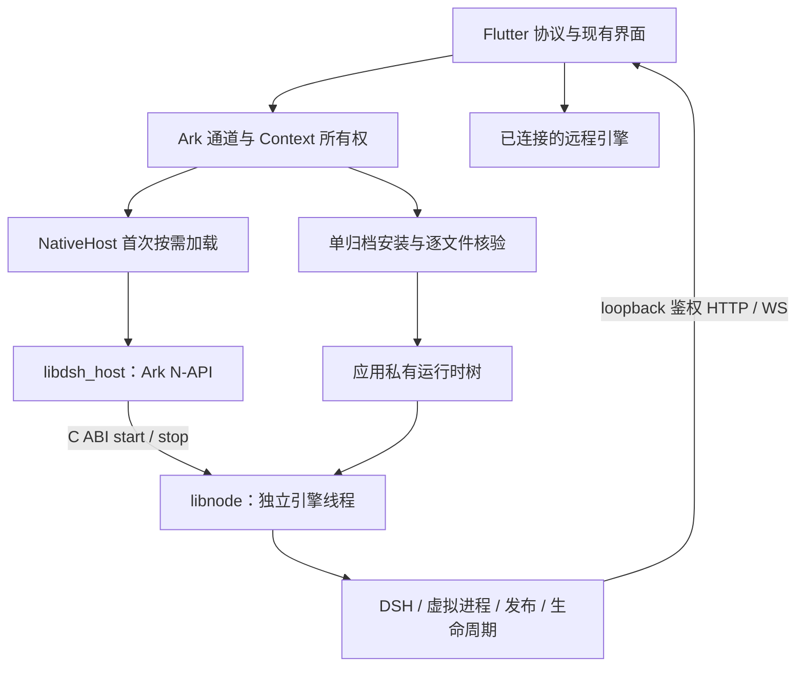
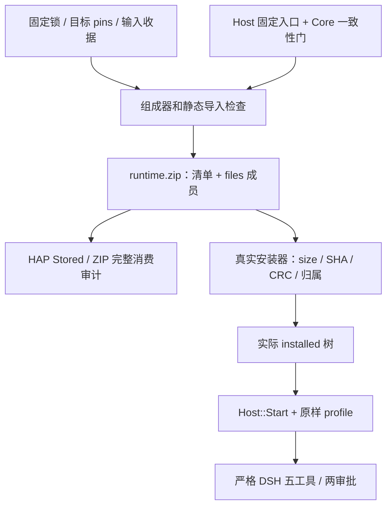

# 鸿蒙本机运行时总览

本总览对应 **530f183906be2a218b1b09000400e01c9a572dba** 及 2026-11-02 的后继交付。它说明当前架构、能力差异、应用关系和仍需验证的边界，不替代各个精确补丁的独立报告。

目前有证据支持的是：固定运行时组成物在 Linux 的实际安装、宿主预检和严格 DSH 回合；多组精确源代码的公开 SDK 严格 ArkTS 编译；部分公开原生模块的离线构建与符号审计。**这些都不等于目标手机上的完整功能通过。** 主线在追加 10 中报告过 530 基底的完整未签名 `--full` HAP 和审计 0 问题，但没有签名、安装或设备运行；本轮后继组合也不能直接沿用该旧完整 HAP 的结论。[证据 E01](evidence-20261102.md#e01)

本文日期是证据截面，旧设计文件中的“尚未实现”“未编译”和旧目录布局保留其历史语境。阅读当前状态先看本文及[证据表](evidence-20261102.md)，再看专题协议。特别是 `capabilities-v1.md` 的示例和早期实现节，不应被复制成固定能力响应。

## 1. 架构和不变约束

应用包含 Flutter、Ark 宿主和一个进程内 Node 实例。远程主机路径可以只使用 Flutter/Ark，不加载本机 Node；本机首次 start 或确实需要安全文件 opener 时才经统一 `NativeHost` 动态加载。`guestRoot`、`getStatus`、未启动 stop 等查询不能为取得一个路径而加载 `.so`。[E03](evidence-20261102.md#e03)

这张图表示组件和数据流，不表示每条边都已经在手机上执行。运行时安装不创建 Node，读取能力清单不安装插件、不加载 addon、不执行探测或恢复。宿主与 Dart 的“本机通道存在”、Node phase、HTTP/WS 连接成功、具体能力 supported 是不同状态。[E02](evidence-20261102.md#e02)、[能力协议](capabilities-v1.md)

### 一次 Node、一个产品预加载入口

通过全部启动前提后，宿主只消耗一次启动机会，在独立线程进入 runner。固定 Node 为 24.22.1，带 `--jitless`，只有 `runtime/ohos/preload.mjs` 一个产品 `--import`；`NODE_OPTIONS` 必须缺省或严格为空。home、workspace、cache、可信原生库目录与六个固定入口在消耗启动机会前检查。实际 Cordis profile 注册虚拟 subprocess/sandbox、lifecycle 和 capabilities，并将默认工作区与 workspaceRoots 传给真实消费者。[E02](evidence-20261102.md#e02)、[E07](evidence-20261102.md#e07)

`start()` 返回只表示接受请求，ready 要等实际监听地址与凭证；`stop()` 返回只表示停止请求，完成要等终态。有效启动后 consumed 不复位，不能在同一 App 进程中再建 Node。正常退出、`process.exit`、未捕获异常的返回路径有 Linux 真实嵌入验证；native fatal error、abort、内存破坏仍可能终止整个 App，没有进程隔离保证。重启走既有 `reopenApp` 与公开 Ability 重启接口，错误回传 Dart，不用 `exit` 冒充成功。[宿主契约](native-host.md)、[进程内退出](embedded-exit.md)、[运行时 v6](runtime-channel-v6.md)

### Ark 与 Node 原生边界

runner 和 linked publication binding 已编入 `libnode.so`，生产包不再依赖 `libdsh_node_runner.so`。Ark 模块使用真正的 Ark `napi_*`；Node 及自编 addon 使用 `dsh_napi_*` / `dsh_node_api_*`。两侧不交换 N-API 对象、C++ 对象或回调。addon 自身导出的 `napi_register_module_v1` / `node_api_module_get_api_version_v1` 保留原名。[符号隔离](napi-isolation.md)

目标 libnode/加载器使用主线固定 Clang 23 与静态 C++ 运行库；Ark 模块使用其 SDK C++ 运行库。实际 ELF 必须通过导出、强导入、NEEDED、NODELETE 和入口检查。离线审计说明待打包字节满足已检查的链接条件，不证明手机 loader、`RTLD_DEFAULT` 查找、真实系统库或启动时序成立。[目标构建说明](../../../runtime/ohos/node/BUILD.md)、[HAP 原生映射](hap-native-libraries.md)

## 2. 运行时、用户数据和原生库分别放在哪里

下表的根来自同一个可信 ApplicationContext。`rootfs` 沿用客户端目录名字，不表示 Linux rootfs、PRoot 或 chroot。Dart 不能传任意根、任意启动参数或替代库目录。[E02](evidence-20261102.md#e02)

| 内容 | 当前路径或载体 | 更新和权限边界 |
|---|---|---|
| 运行时资源 | HAP 唯一 `resources/rawfile/dsh-runtime/runtime.zip`，外层 Stored | 42 的准确组合已独审；目标完整构建仍需主线接入；不是 ELF 存放地 |
| 展开的 JS/JSON/普通资源 | `<filesDir>/dsh-runtime/tree` | 逐文件清单、安装归属与 installing 状态；活动/已消耗 Node 不更新运行树 |
| guestRoot | `<filesDir>/runtime/rootfs` | 同步路径查询不做 manifest 或目录 IO |
| HOME | `<guestRoot>/root` | 宿主固定，启动期环境覆盖受保护 |
| DSH_HOME | `<guestRoot>/root/.dsh` | 私有配置、会话与生命周期记录；不授予用户文件导出权 |
| DSH_AGENTS_HOME | `<guestRoot>/root/.agents` | 共享技能与 AGENTS.md 的真实消费者根 |
| 唯一工作区 | `<guestRoot>/root/workspace` | 传入实际 subprocess 与 sandbox policy |
| 用户产出 | `<guestRoot>/root/workspace/DSH-Go` | `listOutputs` 只列这里，不遍历项目依赖和其他工作区文件 |
| 托管技能 | `<guestRoot>/root/.dsh/skills/<name>` | token/世代/owner 绑定，事务式写入和取消；不等于插件市场安装 |
| 持久引擎日志 | `<filesDir>/dsh-runtime/engine.log` 与 `.1` | 诊断主包已精确独审；只收脱敏后的条目，有界队列和轮转，非崩溃前完整日志保证 |
| 临时文件和 V8 编译缓存 | Context cache 下的运行时专用目录 | 可重建，不能保存唯一业务事实；不允许被重定向到任意目录 |
| native addon | 系统自有 `bundleCodeDir` 与经校验的相对 `nativeLibraryPath` 所定位的库目录 | 固定 `libdsh_flock.so` / `libdsh_require_builtin.so`；不复制 ELF 到数据树 |

托管技能见[managed-skills](managed-skills.md)，产出目录见[outputs-directory-v3](outputs-directory-v3.md)。部分旧文件专题仍写早期 `filesDir/workspace`；当前以 `RuntimePaths.ets` 和上述 v6 布局为准。[E19](evidence-20261102.md#e19)

### 单归档的组成、安装和最终消费

内层清单是第一个 Stored 成员，其他 `files/<path>` 按同一顺序 Deflate；不接纳加密、ZIP64、data descriptor、多卷或未知成员。归档成员与 manifest 一一对应。安装继续核每个文件的 size/SHA、路径和 ELF 禁令，合法 `client.node.js` 不按 `.node` 误拒。未变化文件跳过解压和写出；仍需核树、读账本和提交元数据，不能把一次单文件升级说成只产生该文件大小的 IO。[E09](evidence-20261102.md#e09)、[E10](evidence-20261102.md#e10)

必需入口以实际 Host `File(...)` 与 Core 集合比较为门，组成器和审计器使用这些现有事实，不维护第三份未比对的列表。当前包括 DSH bin、preload、process、sandbox、lifecycle、capabilities；任何一项漏装都必须在启动前被拒。最终验收必须喂入组成器产物、再喂入实际安装结果，不能用开发 npm 前缀代替。[E07](evidence-20261102.md#e07)

当前最终归档 02 的逻辑载荷为 **14,253 个文件、160,395,773 B**；内层 ZIP 为 **48,389,806 B**，SHA256 `45264ae6a136c374a6fc4d9ca43ae8002295ad90f0134cf245bc88a81dd351f3`。实际 installed 树已跑标准和 Node 脚本两组 Host/严格五工具两审批，并在同一树跑 JIT 156/156、strict 156/156。[E10](evidence-20261102.md#e10)

“16,000 文件、167,000,000 B”另有明确的规模夹具，不是上面真实组成物。Linux 的单归档 01 全装一次为 118.881 秒；01→02 的真实一文件升级为 32.945 秒，14,252 个其他 inode 保持原样。两者输入、操作不同，不能相减当作优化率；未清 OS 页缓存、非独占 CPU，也不是手机延迟上界。当前没有普遍冷/热启动加速结论。[E07](evidence-20261102.md#e07)、[E09](evidence-20261102.md#e09)、[E10](evidence-20261102.md#e10)

## 3. 能力对照：保留行为和明确限制

这里的“有实现”不是设备功能认证。界面应读当前连接的能力清单，绑定 bootId；unknown、unsupported、请求失败和无宿主是不同状态。不得由 App 运行在鸿蒙就推断远程引擎也受同样限制。[能力协议](capabilities-v1.md)

### 引擎与工具

| 能力 | 当前后端和可保留行为 | 明确限制 / 替代 | 依据 |
|---|---|---|---|
| write/edit/read/grep/bash | 固定 DSH、真实文件观察与审批、OH 虚拟后端 | 原审批与工作区约束继续成立；既有写入不因取消而回滚 | E02、E07、E10 |
| bash/sh、rg、Git | 私有 just-bash、纯 JS 搜索、isomorphic-git 及既有归属账本 | 命令/参数为实际路由表子集，不等同系统 Bash/Git；未支持命令明确 127 并提示连接电脑 | E04、E07 |
| 流式输出 | 直接 Node 脚本真实两路字节；shell 完成的外层语句分段交付 | shell 单个命令/复合语句内仍缓冲；不承诺两路实时交错完全等同原生 | E04 |
| `node <script>` | 专属真实 Worker，CJS/ESM 原入口、argv、私有 cwd、环境和 batch stdin | 能力值为 `worker-rebased`；非任意 Node CLI，不支持 PTY、`-e` 或 OS 子进程 | E04 |
| Node 脚本路径保护 | 本请求的公开 JS fs/path 适配与 FD 归属 | 不是操作系统沙箱；native binding、后代普通 Worker、检查后换链及 native/RSS 上界另有边界 | E04 |
| Python / WebAssembly | 明确 unsupported，组成排除 just-bash Python/SQLite wasm | 连接电脑；Node 内建 SQLite 是独立能力，不因移除 wasm 而删除 | E04、E07 |
| 原生模块 | 仅固定随 HAP 库及 allowlist 路径 | 不支持任意预编译 addon 或在数据目录重新加载 ELF；能力清单 `nativeModules:null` 仍表示未有设备逐模块观测 | E02 |
| 插件市场 | 随包插件发现/启停保留；安装、更新、卸载在副作用前明确拒绝 | 连接电脑管理；O9 静态标签不授予执行权或保证全部功能 | E18、E20 |
| HTTP/Fetch | 原生产 dispatcher，保留构造器与网络契约 | O5 五项 TODO 有真实 Linux 原生修复证据；目标 libnode 必须采用统一准备器后另验，非完整 Fetch 合规证明 | E05 |
| 会话与发布锁 | 会话锁按实际服务报告；publication 账本另有原生锁 | 会话 `main-thread` 不能写成 `kernel`；发布锁也不能替代会话锁结论 | E02、E22 |
| 原子发布 | 只读暴露 `untried/trying/available/unsupported/disabled-after-crash/unknown` | rename flags、挂载和 seccomp 尚待设备；trying 残留不证明 SIGSYS | E22 |
| 后台与恢复 | O8 先记边界、对账、不重放未知副作用；41 接 Ability 观察 | `may-freeze` 始终保留；computePermission 是资格观察，不表示已创建保活任务 | E08、E23 |

上表不能取代真实命令数组；数组由执行器、工具说明和 O6 共同使用 `runtime/ohos/process/commands.mjs`。当前 `nodeScripts` 还要求可继承的产品 preload 实际存在；不满足时报告 none 并移除 node。旧客户端未知枚举应保守处理，Flutter 穷尽 switch 必须随模型一起合入；主线追加 9 已说明相应接线。[E04](evidence-20261102.md#e04)

### 原生通道

| 通道 | 当前协议行为 | 尚未具备或尚待确认 |
|---|---|---|
| `dsh/runtime` | status/install/start/stop/logs/events、guestRoot、reopenApp、托管技能 | 一进程一次 Node；目标装载/重启/后台真实行为待设备 |
| `dsh/files`、`dsh/media` | 安全 FD 后复制，系统打开/保存、相册确认、DSH-Go 产出列表 | 强制选择打开 App 不支持；URI 提供方写入无跨提供方原子回滚保证 |
| `dsh/app`、`dsh/links` | 时区、固定自身 Ability 回前台、冷/热深链及外来文件及时复制 | 刷新率的 auto/max 靠引擎的 `LTPODispatchHighFrameRate`，真实帧率待设备；后台拉起不绕过系统限制 |
| connectivity_plus | 承载类型列表和事件，失败不伪装 none | 有网络不等于互联网可达；真实 observer 回收待设备 |
| `dsh/notify` | 普通锁屏安全文字提醒、HMAC 导航点击、串行取消 | 通知外审批/拒绝、实况窗不支持；publish 成功不证明已展示 |
| `dsh/web-files` | 系统文档选择、accept 后缀提示、owner 取消与迟到结果隔离 | 无已证的原生可见 WebView 校验；回调取消不等于关闭系统 picker；ArkWeb 临时 URI 上传待设备 |
| `dsh/islands` | Dart 侧与 Android 同协议：`attach`/`setDark`/`setTextZoom`/`pause`/`resume`/`destroy`、`device`、`appPss`，回调 `rendererGone`、`trimMemory`；深色和渲染进程回调经 `fork-fixes` | `device` 无 `webView` 字段；页面跟随、崩溃恢复、岛的内存开销和上屏行为待设备 |
| `dsh/native-files` | 前台用户手势、系统授权 URI、handle 与分块预算读取 | 精确主包已独审；不接任意本地路径，不持久化 grant；真实授权待设备 |
| `dsh/native-media` | 本阶段 audio，固定缓存文件、安全 fd、完成/停止前真实释放归属 | 精确主包已独审；voice/overlay 明确 unsupported，真实播放和焦点待设备 |
| `dsh/performance` | 内存事实、低/中默认、八级热状态和 active uptime 恢复 | 精确主包已独审；不虚构 Android SDK/MPC 或跑分，不输出 high，真实热事件待设备 |
| `dsh/diagnostics` | 公开非唯一设备事实、运行时清单摘要、实际持久日志 | 精确主包已独审及公开 SDK 编译；OH 字段不伪装 Android，未 flush 尾部不保证完整；设备待验 |
| share_plus、`dsh/share` | HMS 发出及冷/热接收候选、URI 即时复制、owner/物理面板归属 | v2 已关闭不同 Context 缓存路径错拒；整体仍 **BLOCKED（UNCOMPILED_HMS）**；dismiss 先到不能猜成功 |
| `dsh/voice` | HMS 识别与公开录音候选，权限生命周期、16 kHz 单声道 16 bit WAV | **UNCOMPILED_HMS**；离线模型接口 unsupported，地区/语言/真实麦克风待验证 |
| `pdfInfo/pdfPage/pdfClose` | HMS PDF 候选、安全副本、renderer/fd/缓存归属，缓存消失可退休 | **UNCOMPILED_HMS**；真实 PDFKit 解码与页图未测；已审公开 fallback 仍可系统打开 |
| `dsh/app.scanQrCode` | 扫码配对电脑：Scan Kit 默认界面扫码（系统页面带相册入口），取消返回 null | **UNCOMPILED_HMS**；模块名依据华为文档离线镜像，真实扫码页、取消码与相册识码待设备 |
| 输入法粘贴 | 39 修复 helper 拒绝/异常路径的 Promise 结算，空值不删除选区 | 主线必须实际采用 prepared HAR；ACL 待项目账号，未加 READ_PASTEBOARD，未接原生 PasteButton fallback |
| `dsh/usage` | 当前不填造假 OH 事实 | **协议 BLOCKED**；v1 sdk 是 Android level、无 platform，需客户端/服务端共同版本化决定 |

通道行为与状态来源分别见 E03、E06、E11–E21；专题入口见末节。三个公开原生主包的编译结论分别绑定各自最小 Entry；顺序增量合成的共享 Entry 只有源码应用证明，不能直接继承为新的完整组合编译结论。HMS 声明占位的严格 ArkTS 0 错误只检查调用方，不能改写上述四个 **UNCOMPILED_HMS**。[证据表](evidence-20261102.md)

## 4. 异步所有权与恢复的共同规则

**逻辑取消与物理资源释放分开。** 网页 owner、Flutter engine、Ability、事件 sink 和 Node 世代可先退休；系统 picker、分享面板、播放器、在途 I/O 或未确认关闭的 FD 仍占物理资源。迟到结果不能交给新 owner，首次回复成功也不能把实际 close/release 尚未完成写成 free。原生文件和音频的新实例恢复反例已经保留，并以真实 FD 验证后继行为；设备 API 的结算时机仍需实测。[E15](evidence-20261102.md#e15)、[E16](evidence-20261102.md#e16)

**暂停原因分开。** 手动 pause 与宿主后台观察分别保存；前台事件不能清除手动暂停，手动 resume 不能越过仍在后台的门。控制请求带单调 revision，前一请求取消后仍可能抵达服务端，因此 Node 同样拒绝倒退。失败只重试同一幂等观察，不重试工具；通过既有 Dart error/notice 展示未同步状态。[E08](evidence-20261102.md#e08)

**副作用未知不等于失败可重做。** prepared、dispatch、outcome、committed、reconciled 分别记录不同事实。dispatch 后没有可靠结果，应保留 result-unknown；HTTP 超时、Worker terminate 或恢复后的长延迟不证明副作用未发生。活动预算只扣已确认的逻辑暂停，凭据到期仍用墙钟；未预告冻结不能由用户态延迟反推精确时长。[生命周期设计](lifecycle.md)、[E23](evidence-20261102.md#e23)

**安全打开不等于内容快照。** native opener 逐层 `openat/O_NOFOLLOW` 固定授权根和已打开 inode，避免字符串检查后换链越界；同 inode 被另一个合法写者原地改写仍可能影响复制。系统导出先由 fd 复制到自有缓存，但不能因此许诺事务一致性或掉电原子性。[文件通道](files-media-channels.md)、[宿主](native-host.md)

## 5. 主要风险及其验收门

| 风险 | 当前证据和限制 | 关闭该项需要什么 |
|---|---|---|
| 新组合只在源码层相容 | 旧包通过不自动覆盖新的 Entry、manifest、pins、导入闭包或资源格式 | 对最终后像普通 apply、完整来源清单、真实 installer→Host→严格回合、准确编译工程再验 |
| Node/Ark 同进程装载 | 有改名和 ELF 门；桌面双 DSO 探针不是手机 loader | 同一签名 HAP 中真实导入、加载顺序、固定 addon、停止/异常/重挂，记录实际库 SHA |
| 系统调用与掉电 | Linux errno/SIGKILL 不证明设备 seccomp、挂载或 fsync 持久性 | 按 M6 受控步骤记录系统版本、真实 mount 与返回值；不以盲探 syscall 代替前提核验 |
| 后台冻结与授权 | Ability→HTTP 有异步窗口；granted 只表示计算模式前置资格 | 无/有 ACL、锁屏/低电量/系统回收、手动暂停重叠、真实工具副作用和恢复记录 |
| 安装原子性与资源释放 | 组件 v2 与最终 42 已精确独审，包含四类审计假通过和 Caller 重试原反例；OH API 行为仍待测 | 对最终设备产物复验失败后重试、坏 ZIP/ELF/中断/原生不可用，且 FD/inflater 归零 |
| Worker 不是 OS 沙箱 | 公共 JS 路径适配有明确逃逸面和检查后竞态 | 按信任模型使用；不对未知 native 插件承诺隔离；越界/取消/FD 重用继续测 |
| 现存 shell 字节差异 | 36 留有独立 open 同路径截尾、二进制 stdout 控制流边界 | 后继小补丁保留原生反例、全组与实际组成物回归；本总览不提前标修复 |
| 系统 UI 与 HMS | 平台替身有明确边界；Share v2 已实证关闭旧193c缓存错拒，HMS SDK 仍未提供 | 真正 HMS SDK 和设备验证取消/授权/跨 App URI与Context路径；不能用占位声明升级状态 |
| 内存、时间、电量 | 记录的是共享 Linux 的具体输入、进程峰值和单样本/20 回合；无设备 P99 | 固定机型/系统/HAP、冷热定义、页缓存和测量工具，给原始样本、取消与后台情境 |
| 日志与缓存 | 脱敏规则有限；缓存可清理；未 flush 日志及轮转无完整掉电协议 | 设备故障/重开/缓存清理、真实脱敏导出、写入耗时与功耗；不宣传完整崩溃日志 |
| 旧构建缓存污染证据 | 曾见旧工程日志/路径，checker 后继专门拒绝不匹配 | 每轮唯一工程、全源前后 SHA、诊断路径、HAP 内 ABC 同一性；有缺项就不计通过 |

完整执行次序和可勾选的结果字段见[真机验证清单](device-validation.md)。上述风险均有具体源码、实证或未测门，不是通过补一个总的“已隔离/可用”布尔值解决。

## 6. 合并与文档导航

冻结基础是 530。42 主补丁已经包含 36 Worker、37 lazy、40 组成、41 lifecycle 的前置后像；纯 530 采用 42 主包时不用再叠这些主包。38 O5 和 39 clipboard 各按自己的构建接入约定处理；43 检查工具与 42 同改 `check-arkts.sh`，共同后像按 42/43 的明确格式差分核对。[E01](evidence-20261102.md#e01)、[E05](evidence-20261102.md#e05)、[E06](evidence-20261102.md#e06)、[E10](evidence-20261102.md#e10)

41 主包含 37，音频/HMS 分享/PDF 的独立主包也含 37，诊断主包包含 42；**不能把所有主补丁直接串联**。对应 feature-only 只适用于其交付说明指定的精确前像；共同 Entry/FilesMedia/manifest 变化按后像合并并重新验最终树。OhosDeviceFacts 由 performance/diagnostics 共享相同字节，不能重复新增或覆盖另一个已接线的 Entry。O5 的 Node 准备调用和单归档的 `build-hap.sh` 旧 manifest 检查属于主线接入要求，本文不越权修改。

| 主题 | 仓库已有协议 / 后继交付文档 |
|---|---|
| 启动与 native | [native-host](native-host.md)、[embedded-exit](embedded-exit.md)、[napi-isolation](napi-isolation.md)、[hap-native-libraries](hap-native-libraries.md)、[startup](startup.md) |
| Runtime / 用户目录 | [runtime-channel](runtime-channel.md)、[runtime-channel-v6](runtime-channel-v6.md)、[managed-skills](managed-skills.md)、[outputs-directory-v3](outputs-directory-v3.md) |
| 能力 / 恢复 / 发布 | [capabilities-v1](capabilities-v1.md)、[lifecycle](lifecycle.md)、[publication-ownership](publication-ownership.md)、[publication-atomic-capability](publication-atomic-capability.md)、[设备前提](M6-3-device-prerequisites.md)；41 的 `host-lifecycle.md` |
| 组成 / 插件 | [runtime-composition](runtime-composition.md)、[plugin-install-refusal](plugin-install-refusal.md)、[android-recipe](android-recipe.md)；单归档的 `runtime-archive.md` / `runtime-archive-composition.md` |
| 公开通道 | [core-channels](core-channels.md)、[app-links](app-links-channels.md)、[files-media](files-media-channels.md)、[notify](notify.md)；33 的 `web-files.md` |
| 新候选 | `native-files.md`、`native-media.md`、`performance-channel.md`、`diagnostics-channel.md`、`hms-share.md`、`voice-channel.md`、`pdf-preview.md`，状态逐项见证据表 |

这份文档不改变代码、UI、权限、锁、Android recipe 或运行时版本。新证据到达时更新具体行及其精确 SHA，不回写历史失败或把不同组合的测试数相加。
