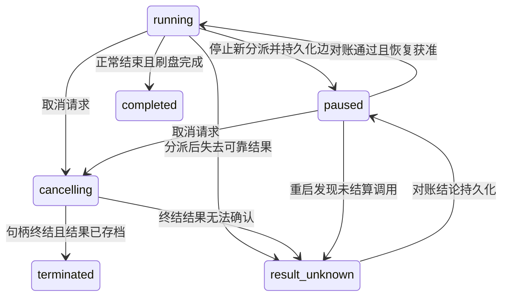

# O8 生命周期与恢复：先行设计

状态：设计先行，后续实现必须另交补丁与实际测试；本文件不代表冻结恢复已经可用。基底 afb5cdd；锁定 DSH0.2.1-rc.4、Node24.22.1。第一阶段一个应用进程内只有一个 Node 实例，存储协调在主 Node 线程。手机冻结时序仍未在真机核实。

## 1. 已有边界及缺口

`dsh-agent-loop/lib/index.js:506–631` 的调度器先 append tool/call，然后 prepare/dispatch；允许工具并发完成，但按模型原始顺序提交结果。`:681–713` 把结果关联至具体 call 事件 seq。这个顺序不能为生命周期功能而打乱。

`dsh-session-checkpoint-policy/lib/index.js` 已在 llm/stream、顶层 tools/execute 和 agent/pre-step 上等待 `ctx.sessions.flush(session)`；刷盘失败时不进入工具或模型请求。O8复用该保障，不另外声称一个未等待的 `session.append()` 已经持久。

原循环在步骤异常时通过 ToolCallRecovery 为悬空调用补结果（同文件`:975–991`）。这只保证会话结构可继续读；它不能证明真实外部副作用没有发生，更不能凭一条失败占位结果安全重放。并发工具 B 已完成但等待 A 的有序提交时，B 的结果尚未进入会话，也需要单独保护。

因此需要主线程维护的**工具边界日志**，记录调用是否已获准分派、结果是否已持久，以及恢复判定。会话日志仍是模型上下文事实来源；边界日志负责填补执行与结果落盘之间的窗口，不替换会话协议或修改 transcript.dart。

## 2. 不可省略的恢复原则

1. 在任意有副作用工具进入执行前，调用前缀与分派记录均必须完成持久化；失败则工具不执行。
2. 工具实际返回后，先持久化可恢复结果，再交给原调度器按模型顺序提交。后继模型请求仍等待原 checkpoint。
3. `dispatch` 已持久但无可靠结果，是**结果未知**，不是“失败所以可以再执行”。在“最后一次落盘”和“真正产生副作用”之间不存在可由普通本地文件事务消除的原子提交；不承诺通用 exactly-once。
4. 自动重试只允许已证明未分派，或工具后端提供并验证了可重复使用的幂等键/明确无副作用读取契约。默认不重放。名称看起来像 read、脚本以 echo 开头都不足以推断没有副作用。
5. 取消请求只表示停止意图。必须等执行句柄终结、所有已启动任务和清理结算后才能标记已终止；超时不等于未产生副作用。
6. 恢复先对账，后决定是否接收新步骤；不能在后台回调中直接再次发送旧 prompt 或工具调用。

## 3. 状态与转换

面向引擎恢复接口的回合状态为：`running`（运行中）、`paused`（暂停）、`cancelling`（取消中）、`terminated`（已终止）、`completed`（已完成）、`result-unknown`（结果未知）。暂停是对调度的状态，不能覆盖仍未结算工具的执行事实。取消期间若结果丢失，最终状态仍可能是 result-unknown。

图中 `result_unknown` 对应线协议字符串 `result-unknown`。unknown 不能仅凭时间流逝自动变成 terminated/completed。恢复结果需写明依据：现存已落盘 tool/result、边界日志的同一次调用结果、后端可验证的幂等查询结果，或人工确定的“保留未知/放弃继续”决定。人工选择新开一次操作也不改写旧调用的事实。

## 4. 边界日志与写入顺序

每个引擎私有数据目录下保存会话边界日志，0600，仅主 Node 线程写；不放在模型可写工作区。标识至少包含 `sessionId`、`callSeq`、`callId`、`turn`、`step`、`bootId`。callId 不能单独作全局键，同名 callId 可来自不同会话。记录只引用已经落盘的工具参数事件，不重复记录凭据或整份环境变量。

每个调用依次经历：

| 记录 | 何时刷盘 | 恢复意义 |
|---|---|---|
| `prepared` | 会话 tool/call 前缀 flush 完成后 | 还未允许进入工具；后续没有 dispatch 时可证明本协议未分派 |
| `dispatch` | 紧贴进入 tools/execute 的真实下游前，等待持久化完成 | 此后丢结果必须视为可能产生副作用 |
| `outcome` | 工具下游已返回，结果可序列化并持久化后 | 恢复时可使用同一次结果，不重新执行工具 |
| `committed` | 原调度器按模型顺序把结果写入会话并 flush 后 | 会话已有权威结果，可在安全检查点压缩边界日志 |
| `reconciled` | 对账结论已确定并刷盘 | 保留判定依据和原调用身份；不删除 unknown 历史 |

记录必须有单调序号与格式版本；恢复只接受校验通过的完整前缀。尾部截断、序号跳跃、错误校验或身份不匹配不能被当作“日志为空”。受影响的在途调用保持未知；写入损坏未处理前不开始新副作用。没有已核实的 fsync 保证时也不能宣称 prepared/dispatch 的顺序已跨掉电成立。

结果比模型内联预算大时可保存到私有结果文件，先刷结果文件、再写含内容摘要和相对引用的 outcome。不能在日志中只存一个未刷盘的临时路径。已有 spill 引用要保留有效期/生命周期，恢复时缺文件就保持未知。后处理会改变结果时，只存最终可交还调度器的版本；实现必须对照 tools/execute 与 finalize 的实际顺序，不能假设 middleware 看到的就是最终模型结果。

并发完成不等于有序提交：B 先返回时先存 B 的 outcome，然后等 A；恢复只在与 callSeq 对齐时补齐缺失结果。若原 ToolCallRecovery 已为同一调用写了占位结果，不能再追加第二个 tool/result 冒充同一调用的首个结果；恢复信息进入独立状态通道，必要的会话继续方式由引擎明确选择，不能偷偷修改历史。

## 5. 冻结后恢复：同一进程

宿主的“将进入后台”通知先关闭新步骤/新工具的分派闸门，持久化 pause 请求和当前边界。可以等待已启动的短任务结算，但不能无限等待一个未知的网络操作；未结算调用保留为在途，不能写成已停止。需要取消时走已有 signal 与句柄结束协议，不在 UI 回调直接伪造成功。

系统实际冻结可能没有给 JS 预告。恢复后首先识别是否还是同一 bootId，读取实际执行句柄和已完成 promise/worker 消息，对照会话及边界日志。仍存活的同一个操作继续等待或明确取消，不能再创建一份；网络连接需要重验，过期连接不靠旧心跳状态判断健康。先检查接收队列中的已到达结果，再决定未知状态，避免把恢复瞬间到达的完成消息当作丢失。

宿主回调只表示应用状态变化，不证明内核准确冻结了多少毫秒。仅靠 Date.now 与 performance.now 的差值不能区分 SIGSTOP、CPU繁忙和调度延迟。若没有可信的暂停起止观测，就不能从“事件循环一段时间没运行”反推出精确冻结时长。

## 6. 进程被杀后重启

新 bootId，没有旧 worker、promise、fd 或 AbortController 的可用引用。按如下顺序恢复：

1. 取得会话写权限；读完整边界日志与会话已落盘前缀，校验身份和顺序。
2. 会话已有匹配 tool/result：接受其事实，不重做工具；更新边界状态。
3. 有可靠 outcome、会话尚未提交：通过原调度器的恢复入口恢复这次结果，维持源调用与顺序；不会重跑工具。
4. 只有 prepared，且日志完整证明无 dispatch：记录未分派；可在正常审批与预算规则下重新规划。
5. 有 dispatch 但无可靠结果：置 result-unknown。文件内容、git HEAD、远端幂等状态等只能由该工具专属的只读对账器解释；没有对账器就不自动重试。
6. 任何不确定恢复结论向 App 明确暴露。当前回合可保持暂停；其他独立会话是否继续按资源/锁隔离决定，不把所有工作一并误判失败。

对 write/edit：仅看到目标文件存在或内容看似符合，不足以证明全部步骤成功，也不允许自动覆盖别人后来的修改。记录可信前后摘要/目标身份可作为证据，但普通基于路径的摘要不是通用事务。对网络写入：只有远端明确提供的幂等键及状态查询能给出可靠重试依据，HTTP超时自身不能。

## 7. 三种时间

| 时间用途 | 时钟/恢复规则 | 禁止行为 |
|---|---|---|
| 工具执行预算 | 单调活动预算；只扣除本引擎已经确认进入逻辑暂停的时段，或可信宿主提供的可核对冻结区间 | 把每次恢复都重置为完整预算；凭长延迟猜暂停时长 |
| 连接/心跳期限 | 恢复立即重验传输、重建失效连接，并重新开始新连接的心跳 | 认为冻结前最后一次ping成功即可继续信任socket |
| token、签名、证书有效期 | 真实墙钟，按服务端/系统原有校验；过期重新认证 | 给凭据有效期减去冻结时间，或把认证失败当可无条件重试写请求 |

现有 dsh-tool-call-timeout-policy、dsh-bash-local、fs-search、网络适配器均有自己的截止时间；只换最外层计时器不足以实现冻结排除。后续补丁需逐项接入同一活动预算或保留明确限制。原 AbortSignal 一旦已 aborted 不能复活；已超时的执行应按真实结算/未知状态对账，而非为恢复复制出一个新 signal 自动重跑。

对未预告的 SIGSTOP，JS 无法在被冻结期间执行 pause 写盘。验收必须分别覆盖“先收到暂停并确认后冻结”和“直接冻结”两种情况。前者可精确验证逻辑暂停预算；后者验证保守对账和不重复副作用，不虚称能从用户态精确还原所有冻结区间。

## 8. 接入方案与范围

新增实现放 `runtime/ohos/lifecycle/`。通过 OHOS Cordis 服务的工具边界接入，确有需要再加小型、固定版本的 `runtime/patches/*.diff`。默认平台和Android完全不注册；不全局改 Date、setTimeout、fs 或其他 Node 内建。任务自己的worker/句柄可以接受生命周期通知，不篡改无关库的全局时钟。

O6 的 `background.resume` 只有实现与测试通过后才报告 reconcile；当前设计阶段仍是 none/unknown。生命周期状态查询与pause/resume/cancel命令走已鉴权的引擎接口，主机回调通过O7私有通道进入；UI与鸿蒙前台/后台原生接线由本机完成。能力查询本身绝不触发重试。

O3主线程锁只能排除本Node协调器内的冲突；进程重启时所有临时锁消失，不能把锁不存在当工具没执行。原生flock仍待SDK/设备验证。边界日志恢复与原会话文件格式迁移分开，不修改已有迁移版本的含义。

## 9. 必须先失败再通过的测试

| 场景 | 观察与成功条件 |
|---|---|
| 调用前刷盘失败 | 工具副作用计数为0，原异常可见 |
| dispatch后、结果落盘前杀进程 | 重启为unknown，副作用计数仍1，不自动再执行 |
| outcome已刷盘、会话结果未提交时杀进程 | 恢复同一次结果，callSeq对应正确，副作用不重复 |
| A慢B快并发后杀进程 | B已落盘结果保留，最终结果仍按模型顺序，不漏/不双写 |
| 先暂停确认，再SIGSTOP/SIGCONT | 逻辑活动预算不计暂停时长，墙钟token仍会过期 |
| 未预告SIGSTOP/SIGCONT | 不凭延迟猜冻结；过期预算/连接得到明确结果，不重放写操作 |
| 取消与完成同时到达 | 只结算一次，等待句柄退出，不把已完成结果覆盖成未执行 |
| 中途日志截断/校验错误 | 不能读成新空会话；未知状态保留，阻止新副作用 |
| 恢复时结果文件丢失 | 明确unknown，不把缺失内容当空成功结果 |
| 新旧bootId/不同会话重复callId | 不混用句柄、结果或预算 |
| Android/普通Linux | 未启用OH服务时原事件/超时/调用轨迹相同 |

测试控制器在引擎外负责 SIGSTOP/SIGCONT 和 SIGKILL；引擎内仍保留 O0 的 child_process 禁令。使用真实本地副作用文件和本地HTTP计数服务，不能只把内存状态序列当恢复证明。每个注入点由握手确认后再发信号，避免靠 sleep 猜时序。手机前后台、被系统回收、数据目录fsync和宿主回调顺序仍列入真机清单。
